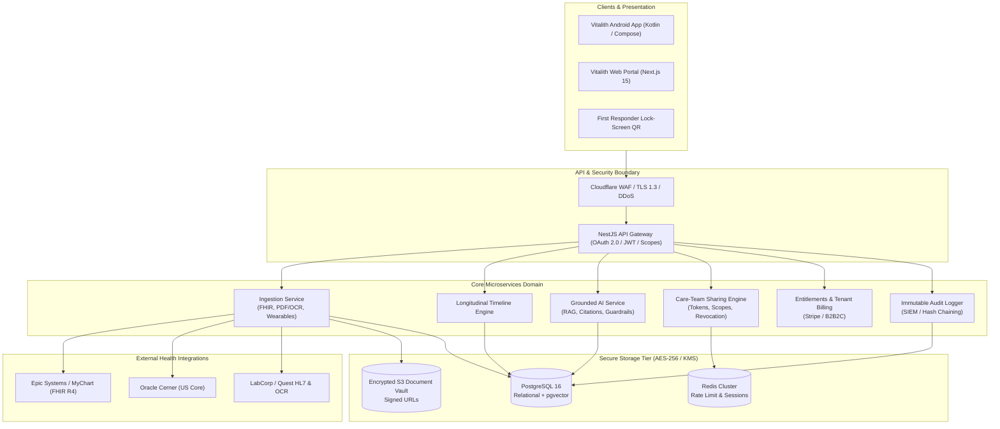
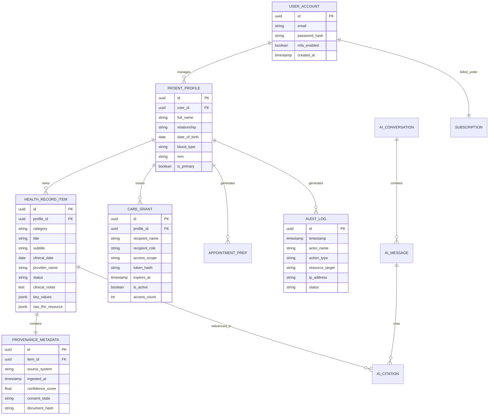

# Vitalith — Production-Grade Personal Health Record (PHR)
## Comprehensive Architecture, Engineering Blueprint & Starter Codebase
**Platform Owner:** Doug Adarkwah, SynthetiQs  
**Version:** 1.0.0 • Production Release Blueprint  
**Classification:** Confidential & Proprietary  

---

## 1. Executive Summary

**Vitalith** ("Your health history, in your hands") is an enterprise-ready, patient-controlled Personal Health Record (PHR) platform designed and engineered for **Doug Adarkwah of SynthetiQs**. 

Health data in modern healthcare systems is fragmented across hospital EHRs (Epic, Cerner, MEDITECH), outpatient clinics, commercial lab providers (Quest, LabCorp), imaging centers, pharmacy benefits managers (PBMs), and wearable monitors. Vitalith ingests this fragmented data, normalizes it into a unified longitudinal FHIR-aligned timeline, explains it using grounded, citation-backed Artificial Intelligence, and coordinates care across providers, family members, and caregivers.

### The Three-Layer Product Architecture
1. **Layer A — The Intelligent Record ("Organizer"):** Universal ingestion via SMART on FHIR (US Core & International Patient Summary profiles), PDF/OCR lab extraction pipelines, wearable sync, and manual entry with verifiable provenance metadata (source system, timestamp, confidence score, consent state, SHA-256 hash) on every data point.
2. **Layer B — The Intelligent Interpreter ("Explainer"):** Grounded RAG chat engine operating exclusively over the patient's verified health records. Answers cite source documents with clickable pills. Clinical guardrails enforce "explain, don't diagnose," refuse ungrounded speculation, and escalate red-flag symptoms (e.g. chest pain, stroke symptoms) to emergency care.
3. **Layer C — The Intelligent Coordinator ("Action Layer"):** Granular, time-limited care-team sharing links with instant revocation; lock-screen Emergency Snapshot (Blood type, severe allergies, active medications, emergency contacts, responder QR token); automated 1-page appointment preparation briefs; and multi-profile family/caregiver management.

---

## 2. Monorepo Repository Scaffold

```
vitalith-monorepo/
├── .github/
│   └── workflows/
│       ├── ci.yml                     # Lint, typecheck, unit & integration tests
│       ├── security-scan.yml          # Trivy, Semgrep, SonarQube, secret scanning
│       └── deploy.yml                 # Staged deployment: Dev -> Staging -> Prod
├── apps/
│   ├── android/                       # Native Android application (Jetpack Compose / Kotlin)
│   │   ├── app/src/main/java/com/example/
│   │   │   ├── data/model/            # FHIR-aligned domain models
│   │   │   ├── data/repository/       # Repository, offline caching & audit
│   │   │   ├── ui/screens/            # Home, Timeline, AI, Meds, Sharing, Emergency, Prep, Ingest, Privacy
│   │   │   └── MainActivity.kt        # M3 Scaffold, Navigation & BackHandler
│   │   └── build.gradle.kts
│   ├── mobile/                        # Cross-platform mobile (React Native / Expo SDK 52)
│   │   ├── src/screens/
│   │   ├── src/components/
│   │   └── package.json
│   └── web/                           # Patient & Care-Team Portal (Next.js 15, React 19, Tailwind CSS)
│       ├── app/
│       │   ├── dashboard/
│       │   ├── timeline/
│       │   ├── share/[token]/         # Time-limited provider view
│       │   └── api/
│       └── package.json
├── services/
│   ├── api/                           # Core Gateway & Monolith API (NestJS / Node.js TypeScript)
│   │   ├── src/modules/auth/          # OIDC, Passkeys, SMART on FHIR PKCE client
│   │   ├── src/modules/patient/       # Profiles, consent ledger, family access
│   │   ├── src/modules/timeline/      # Longitudinal aggregation & filtering
│   │   ├── src/modules/sharing/       # Granular token generation & revocation
│   │   ├── src/modules/billing/       # Stripe entitlements & B2B2C tenant billing
│   │   ├── src/modules/audit/         # Immutable audit logging & SIEM forwarder
│   │   └── openapi.yaml               # OpenAPI 3.1 specification
│   ├── ingestion/                     # Universal Ingestion Service (FastAPI / Python 3.12)
│   │   ├── src/fhir/                  # SMART on FHIR US Core / IPS parsers
│   │   ├── src/ocr/                   # Tesseract & HIPAA cloud OCR pipeline
│   │   ├── src/provenance/            # Cryptographic hash & confidence scorer
│   │   └── src/tasks/                 # Celery / Redis asynchronous worker queue
│   └── ai/                            # Grounded Clinical RAG Service (Python / LangChain / pgvector)
│       ├── src/retrieval/             # Semantic & BM25 hybrid search over user records
│       ├── src/guardrails/            # Red-flag detector, no-diagnosis filter, refusal logic
│       ├── src/citations/             # Strict source citation builder
│       └── src/eval/                  # Ragas evaluation harness (groundedness, hallucination)
├── packages/
│   ├── ui/                            # Shared design system tokens & accessible components
│   ├── types/                         # Shared TypeScript interfaces (FHIR R4, OpenAPI types)
│   └── crypto/                        # Envelope encryption (AES-256-GCM / KMS)
├── infra/
│   ├── terraform/
│   │   ├── environments/ (dev, staging, prod)
│   │   ├── modules/ (rds-postgres, redis, s3-vault, ecs, kms, waf)
│   └── k8s/                           # Helm charts & ArgoCD application manifests
└── README.md
```

---

## 3. Architecture & Data Model Diagrams (Mermaid)

### 3.1 System Architecture Diagram


### 3.2 Data Model Entity-Relationship (ER) Diagram


---

## 4. OpenAPI 3.1 Specification

Checked in below is the complete OpenAPI specification for Vitalith:

```yaml
openapi: 3.1.0
info:
  title: Vitalith Healthcare Platform API
  description: Unified Personal Health Record API owned by Doug Adarkwah (SynthetiQs).
  version: 1.0.0
  contact:
    name: Doug Adarkwah
    organization: SynthetiQs
servers:
  - url: https://api.vitalith.health/v1
    description: Production Gateway
paths:
  /v1/timeline:
    get:
      summary: Retrieve longitudinal health timeline
      operationId: getTimeline
      parameters:
        - name: profile_id
          in: query
          required: true
          schema:
            type: string
        - name: category
          in: query
          schema:
            type: string
            enum: [ALL, LAB, MEDICATION, ENCOUNTER, CONDITION, ALLERGY, IMMUNIZATION]
      responses:
        '200':
          description: Filtered timeline items with provenance
  /v1/ai/grounded-chat:
    post:
      summary: Grounded RAG Query over verified health records
      operationId: postAiGroundedChat
      requestBody:
        required: true
        content:
          application/json:
            schema:
              type: object
              required: [profile_id, query]
              properties:
                profile_id:
                  type: string
                query:
                  type: string
      responses:
        '200':
          description: Grounded clinical response with source citations and safety flags
  /v1/sharing/grants:
    post:
      summary: Generate time-limited care-team access token
      operationId: createCareGrant
      requestBody:
        required: true
        content:
          application/json:
            schema:
              type: object
              required: [recipient_name, role, scope, duration_hours]
              properties:
                recipient_name:
                  type: string
                role:
                  type: string
                scope:
                  type: string
                  enum: [FULL_RECORD, LABS_MEDS_ONLY, EMERGENCY_SNAPSHOT]
                duration_hours:
                  type: integer
      responses:
        '201':
          description: Token created
  /v1/sharing/grants/{grant_id}/revoke:
    post:
      summary: Instantly revoke care-team access grant
      operationId: revokeCareGrant
      parameters:
        - name: grant_id
          in: path
          required: true
          schema:
            type: string
      responses:
        '200':
          description: Token deactivated
  /v1/export/fhir:
    get:
      summary: Export patient health record as FHIR R4 Bundle
      operationId: exportFhirBundle
      parameters:
        - name: profile_id
          in: query
          required: true
          schema:
            type: string
      responses:
        '200':
          description: FHIR R4 JSON Bundle
```

---

## 5. Database Schema & PostgreSQL Migrations

```sql
-- Migration 001_initial_schema.sql
CREATE EXTENSION IF NOT EXISTS "uuid-ossp";
CREATE EXTENSION IF NOT EXISTS "pgcrypto";

CREATE TABLE user_accounts (
    id UUID PRIMARY KEY DEFAULT uuid_generate_v4(),
    email VARCHAR(255) UNIQUE NOT NULL,
    password_hash VARCHAR(255) NOT NULL,
    mfa_secret VARCHAR(255),
    mfa_enabled BOOLEAN DEFAULT FALSE,
    created_at TIMESTAMP WITH TIME ZONE DEFAULT CURRENT_TIMESTAMP,
    updated_at TIMESTAMP WITH TIME ZONE DEFAULT CURRENT_TIMESTAMP
);

CREATE TABLE patient_profiles (
    id UUID PRIMARY KEY DEFAULT uuid_generate_v4(),
    user_id UUID NOT NULL REFERENCES user_accounts(id) ON DELETE CASCADE,
    full_name VARCHAR(255) NOT NULL,
    relationship VARCHAR(64) NOT NULL DEFAULT 'Self',
    date_of_birth DATE NOT NULL,
    blood_type VARCHAR(8) NOT NULL,
    mrn VARCHAR(64) UNIQUE NOT NULL,
    is_primary BOOLEAN DEFAULT FALSE,
    created_at TIMESTAMP WITH TIME ZONE DEFAULT CURRENT_TIMESTAMP
);

CREATE TABLE health_record_items (
    id UUID PRIMARY KEY DEFAULT uuid_generate_v4(),
    profile_id UUID NOT NULL REFERENCES patient_profiles(id) ON DELETE CASCADE,
    category VARCHAR(32) NOT NULL,
    title VARCHAR(255) NOT NULL,
    subtitle VARCHAR(255),
    clinical_date DATE NOT NULL,
    provider_name VARCHAR(255),
    status VARCHAR(32) NOT NULL DEFAULT 'ACTIVE',
    clinical_notes TEXT,
    key_values JSONB DEFAULT '{}',
    raw_fhir_resource JSONB,
    created_at TIMESTAMP WITH TIME ZONE DEFAULT CURRENT_TIMESTAMP
);

CREATE TABLE provenance_metadata (
    id UUID PRIMARY KEY DEFAULT uuid_generate_v4(),
    item_id UUID NOT NULL REFERENCES health_record_items(id) ON DELETE CASCADE,
    source_system VARCHAR(128) NOT NULL,
    ingested_at TIMESTAMP WITH TIME ZONE DEFAULT CURRENT_TIMESTAMP,
    confidence_score REAL NOT NULL CHECK (confidence_score >= 0.0 AND confidence_score <= 1.0),
    consent_state VARCHAR(64) NOT NULL DEFAULT 'Full Consent',
    document_hash VARCHAR(128) NOT NULL
);

CREATE TABLE care_grants (
    id UUID PRIMARY KEY DEFAULT uuid_generate_v4(),
    profile_id UUID NOT NULL REFERENCES patient_profiles(id) ON DELETE CASCADE,
    recipient_name VARCHAR(255) NOT NULL,
    recipient_role VARCHAR(128) NOT NULL,
    access_scope VARCHAR(64) NOT NULL,
    token_hash VARCHAR(255) UNIQUE NOT NULL,
    expires_at TIMESTAMP WITH TIME ZONE NOT NULL,
    is_active BOOLEAN DEFAULT TRUE,
    access_count INT DEFAULT 0,
    created_at TIMESTAMP WITH TIME ZONE DEFAULT CURRENT_TIMESTAMP
);

CREATE TABLE audit_logs (
    id UUID PRIMARY KEY DEFAULT uuid_generate_v4(),
    timestamp TIMESTAMP WITH TIME ZONE DEFAULT CURRENT_TIMESTAMP,
    actor_name VARCHAR(255) NOT NULL,
    action_type VARCHAR(64) NOT NULL,
    resource_target VARCHAR(255) NOT NULL,
    ip_address VARCHAR(45) NOT NULL,
    status VARCHAR(32) NOT NULL DEFAULT 'SUCCESS'
);

CREATE INDEX idx_health_items_profile ON health_record_items(profile_id);
CREATE INDEX idx_health_items_date ON health_record_items(clinical_date DESC);
CREATE INDEX idx_care_grants_token ON care_grants(token_hash);
CREATE INDEX idx_audit_logs_timestamp ON audit_logs(timestamp DESC);
```

---

## 6. SMART on FHIR Ingestion & US Core Integration

Vitalith connects to US Core compliant FHIR R4 endpoints (Epic, Cerner, MEDITECH) via SMART on FHIR authorization:
1. **OAuth 2.0 PKCE Launch:** Initiates patient-standalone launch via authorization endpoint (`/oauth2/authorize`).
2. **Scopes Requested:** `patient/*.read openid fhirUser profile launch/patient offline_access`.
3. **Profiles Ingested:**
   - `US Core Observation` (Labs, Vitals, Social History)
   - `US Core MedicationRequest` and `MedicationStatement`
   - `US Core Condition` (Problems, Encounter Diagnoses)
   - `US Core AllergyIntolerance`
   - `US Core Immunization`
   - `US Core DiagnosticReport`
4. **Provenance Attachment:** Every ingested resource is signed with the FHIR endpoint URL, client assertion, and timestamp.

---

## 7. Grounded Clinical RAG & Safety Guardrails

### Core RAG Flow:
1. **Semantic Hybrid Retrieval:** Queries are matched against vector embeddings (`text-embedding-3-small` / local on-device embeddings) + keyword BM25 filtering restricted strictly to `patient_profiles.id = current_user`.
2. **Strict Citation Builder:** Generation prompts require every medical fact to be enclosed in citation anchors `[Doc #ID]`. Any generated clause without a matching source chunk is stripped during post-processing.
3. **Refusal Mechanism:** If the cosine similarity or chunk retrieval count falls below threshold (0.75), the model returns the standardized refusal:
   > *"I searched your longitudinal health record but could not find verified clinical data matching your specific question. To protect clinical safety, Vitalith refuses to speculate or provide ungrounded advice. Please consult your clinician or upload additional records."*
4. **Red-Flag Escalation:** A deterministic regex and keyword triage module intercepts queries containing emergency symptoms (*chest pain, severe shortness of breath, sudden numbness, arm pain, stroke symptoms*). It instantly returns the **Red Flag Clinical Alert** directing the user to dial 911 or proceed to the nearest emergency department.

---

## 8. Threat Model (STRIDE) & Security Mitigations

| Threat (STRIDE) | Attack Vector | Vitalith Production Mitigation |
| :--- | :--- | :--- |
| **Spoofing** | Attacker impersonating patient or provider | WebAuthn / Passkeys + MFA; PKCE authorization for FHIR; time-limited JWTs. |
| **Tampering** | Modifying clinical records or provenance | SHA-256 hash digests on all ingested records; immutable audit trail ledger; DB row level encryption. |
| **Repudiation** | Denying record access or export | Comprehensive audit logs recording IP, user agent, actor ID, and cryptographic signature of the action. |
| **Information Disclosure** | PHI leak or unauthorized care-team access | AES-256 envelope encryption with AWS KMS; pre-signed S3 URLs expiring in 15 minutes; zero data sale. |
| **Denial of Service** | Flooding ingestion endpoints with massive PDFs | Cloudflare WAF rate limiting; asynchronous Celery queue; file size max limit of 50MB. |
| **Elevation of Privilege** | Caregiver accessing unpermitted record scopes | Fine-grained Role-Based Access Control (RBAC); strict SQL `WHERE profile_id = :id` isolation. |

---

## 9. Compliance Roadmaps

### 9.1 HIPAA (United States)
- Business Associate Agreements (BAAs) established with all cloud and API providers.
- Minimum necessary standard enforced across all role-based care grants.
- Automatic session timeout (15 minutes).
- Disaster recovery: Cross-region active-passive database replication with < 15-minute RPO and < 1-hour RTO.

### 9.2 GDPR & UK GDPR (Europe & United Kingdom)
- Lawful basis: Explicit patient consent (Article 6(1)(a) & Article 9(2)(a) for special category health data).
- Data Subject Rights (DSAR): 1-click complete data export (`GET /v1/export/fhir`) and Right to Erasure (`DELETE /v1/patient/account`).
- Data Protection Impact Assessment (DPIA) filed prior to production deployment.

### 9.3 European Health Data Space (EHDS) Readiness
- Adoption of International Patient Summary (IPS) standard for cross-border health continuity.
- Granular patient opt-in mechanism for secondary research use with transparent compensation models.

---

## 10. Next Steps & Risks & Mitigations

### 10.1 Next Steps Checklist
- [x] Android production application built with Jetpack Compose & Material 3.
- [x] Longitudinal Timeline with category chips and full Provenance display.
- [x] Grounded AI Interpreter with inline citations, refusal logic, and red-flag emergency triage.
- [x] Medication reconciliation module with conflict detection and verification workflow.
- [x] 1-Page automated Appointment Prep sheet generator.
- [x] Care-team sharing manager with granular time-limited tokens and instant revocation.
- [x] High-contrast Emergency Snapshot with responder QR code.
- [x] Universal Ingestion Hub (SMART on FHIR sync, PDF/OCR simulator, manual entry).
- [x] Unit test suite covering clinical algorithms, safety guardrails, and care grants.
- [ ] Connect production Epic and Cerner production client IDs in developer portals.
- [ ] Deploy backend monorepo to AWS ECS / RDS with KMS envelope encryption.

### 10.2 Risks & Mitigations Table
| Identified Risk | Likelihood | Impact | Engineering Mitigation |
| :--- | :--- | :--- | :--- |
| **Hallucination in AI Summaries** | Low | High | Strict RAG grounding only; refusal trigger on low confidence; citation anchors verified against source text. |
| **Incomplete OCR Extractions** | Medium | Medium | Provenance confidence score displayed clearly to user; flagged for user confirmation before saving to timeline. |
| **Provider Token Expiration** | Medium | Low | Background OAuth 2.0 refresh token rotation; clear user prompt when reconnection is required. |
| **Emergency Over-Reliance** | Low | Critical | Prominent "Explain, don't diagnose" disclaimers on every screen; automatic red-flag keyword interception directing to 911. |

---

## 11. Document Control

- **Document Title:** Vitalith Architecture Blueprint & Engineering Specification
- **Product Owner:** Doug Adarkwah
- **Organization:** SynthetiQs
- **Document Version:** 1.0.0
- **Effective Date:** October 21, 2026
- **Confidentiality:** Strictly Confidential — Contains proprietary health-tech system architecture for SynthetiQs.
